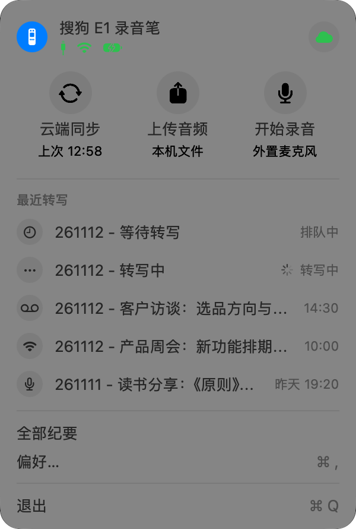
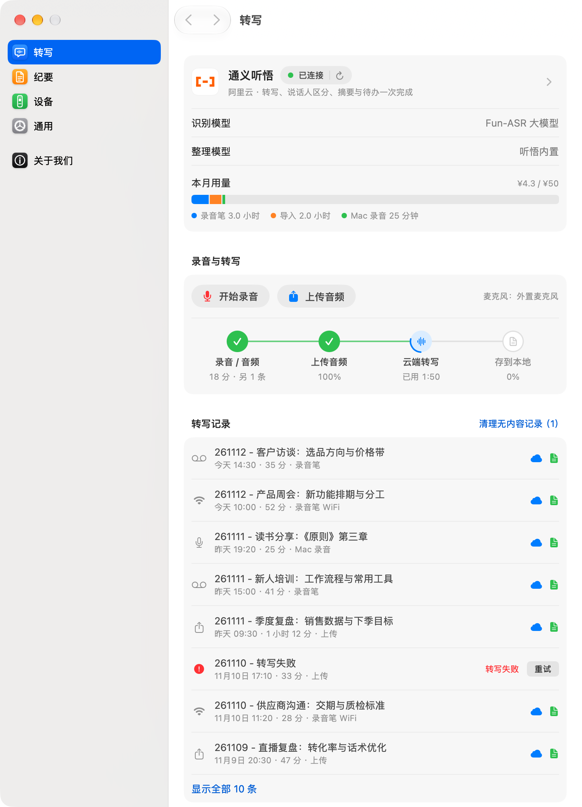
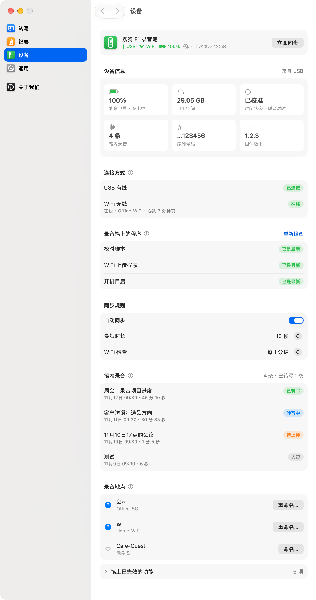
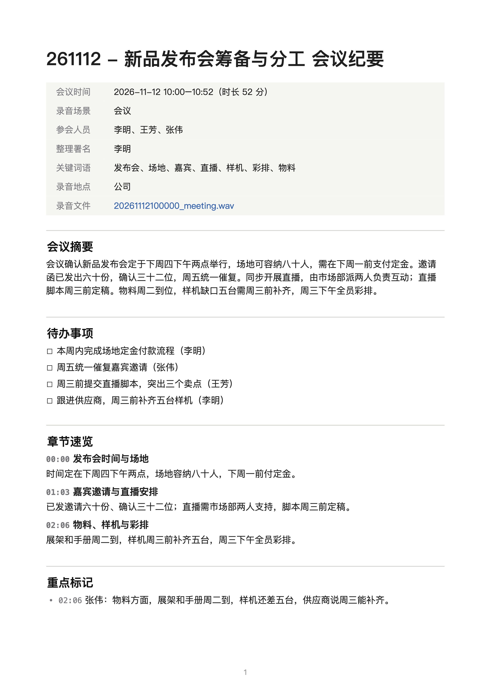

# E1录音助手

让官方停服后的**搜狗 AI 录音笔 E1** 继续可用：录音自动从笔上到 Mac（USB 或 WiFi），交给你自己阿里云账号里的语音服务转写，整理成会议纪要（Markdown / Word / PDF），存进你的笔记库或任意文件夹。

> 本项目与搜狗、阿里云均无关联。仓库里没有任何搜狗固件或服务端代码，也不连接搜狗的服务器；只处理**你自己这支笔**里的录音。

<p align="center">
  
  &nbsp;
  
</p>

## 能做什么

- **自动同步**：插上 USB 即拷贝新录音；设置 WiFi 同步后，笔连上网就把新录音传到你自己的阿里云 OSS「信箱」，Mac 开着时取回转写。同一条录音只转写一次，不会重复收费。
- **云端转写**：通义听悟一次完成转写、说话人区分、摘要、待办、章节；也可选百炼语音（Fun-ASR + 千问整理），或任意 OpenAI 兼容接口。
- **会议纪要**：内置 5 套模板（标准纪要、决策会议、访谈记录、课堂笔记、极简速记），也可用自己的模板；保存为 Markdown、Word 或 PDF。标题统一为「日期 - AI 标题」，例如「261112 - 新品发布会筹备与分工」。[看一份示例纪要](docs/示例纪要.md)。
- **Mac 录音与上传**：用 Mac 的麦克风直接录（可暂停），或上传本机音频文件，同样转写成纪要。
- **笔端校时**：笔断电后时钟会乱，App 会在笔上装一个小脚本，联网后自动对时。
- **用量与预算**：按来源统计本月转写时长和估算费用，接近预算时提醒。
- **录音地点、发言人、热词**：给笔连过的 WiFi 起名（如「公司」「家」），纪要里写上地点；给发言人命名；常用人名和术语设为热词。
- **菜单栏常驻**：开机自动启动，不占程序坞；支持深色模式和读屏。

## 安装

1. 到 [Releases](../../releases) 下载最新的 `E1Recorder-x.y.z.dmg`，把应用拖进「应用程序」。
2. 第一次打开：右键点应用 →「打开」→ 再点「打开」（应用未经 Apple 公证，只需这样操作一次）。
3. 跟着 3 页引导设置好就能用：
   1. **连接录音笔**：在笔上打开 adb（见下），用数据线连上 Mac，一键装上校时脚本；
   2. **转写与纪要**：选通义听悟或百炼语音，填入百炼访问密钥（只存在本机钥匙串），通义听悟还要填应用编号（`tw_` 开头）；选纪要存放位置；
   3. **WiFi 同步（可选）**：按步骤创建自己的 OSS 存储空间和两把钥匙，再把上传程序装到笔上。

### 录音笔准备（只需一次）

在笔上打开 adb：**通用设置 → 关于本机 → 连续点「MAC 地址」→ 开发者模式 → 基本设置 → adb 打开**。之后插上 USB，App 就能读取录音。

装到笔上的程序（校时脚本、WiFi 上传程序、开机自启脚本）都内置在 App 里，只写在笔的数据分区 `/userdata`，不改系统和固件。它们的状态和更新都在「偏好 › 设备 › 录音笔上的程序」。

<p align="center">
  
  &nbsp;
  
</p>

## 费用

转写走你自己的阿里云账号，按量计费（2026 年 11 月价格）：通义听悟约 ¥0.79/小时（转写约 ¥0.6，摘要等分析约 ¥0.19），百炼语音约 ¥0.81/小时。OSS 信箱只临时放几天录音，费用可以忽略。建议在阿里云「费用中心」也设一个预算提醒。

## 隐私

- 访问密钥和 WiFi 钥匙只存在 macOS 钥匙串，不写进文件，导出配置时也不会带走。
- 录音只上传到你自己账号下的服务：通义听悟的临时存储（48 小时后自动删除）和你的 OSS 信箱（Mac 取回后即删除）。
- 笔上的钥匙只能上传，Mac 的钥匙只能读取和删除信箱这一个文件夹。
- 纪要只写在本机。「导出诊断信息」不含密钥、录音标题和网络名称。

## 已知局限

- 需要 macOS 15 或更新版本，以及一个阿里云账号。
- 应用没有经过 Apple 公证：第一次打开要右键「打开」，每次升级后第一次启动会请求一次钥匙串授权。
- 录音笔息屏约 5 分钟后会休眠，WiFi 上传只在笔醒着时进行；长录音可能要等下次亮屏才传完，急用就插 USB。
- 识别出的有效文字不足 10 个字的录音不生成纪要，只留一条「无实质内容」记录，可一键清理。
- 通义听悟的热词需要在百炼控制台里设置；App 里的热词对百炼语音和自定义平台生效。

## 从源码构建

需要 Xcode 26 或更新版本（编译 Icon Composer 图标）、`adb`（`brew install android-platform-tools`）和 Go（`brew install go`，编译笔上的上传程序）。

```bash
cd app
./build.sh                         # 产物在 app/build/：E1录音助手.app 和 .dmg（Apple 芯片与 Intel 通用）
swift test                         # 标题规则、文件命名、Markdown 导出、在线判定等单元测试
(cd ../pen/e1wifi && go test .)    # 笔上上传程序的测试（模拟云端）
```

开发用：`PREVIEW=1 ./build.sh` 打出的版本支持截图模式，例如 `…/E1Recorder -uiPreview YES -previewDemo YES -previewSection platform`，全部使用虚构的示例数据，不读写真实设置和记录。钥匙串里有自签名的代码签名证书时（名字写在 `app/.signing-identity`），打包会用它签名。

## 目录

| 路径 | 内容 |
|---|---|
| `app/Sources/E1Recorder` | SwiftUI 菜单栏应用：`Pipeline*.swift` 同步与转写流程，`*Page.swift` 各设置页，`Migrations.swift` 一次性数据迁移，`Log.swift` 日志与诊断 |
| `app/Tests` | 单元测试；`DemoNoteTests` 用应用自己的模板生成示例纪要 |
| `app/Resources` | 应用图标（Icon Composer 格式）及图层绘制脚本 |
| `pen/` | 装到录音笔上的程序：校时脚本 `e1sync.sh`、开机自启 `auto_reboot.sh`、WiFi 上传程序 `e1wifi/`（Go，含测试）。都只写 `/userdata` |
| `docs/` | 截图与示例纪要（全部是虚构数据） |

## 许可

MIT。应用内附带的 `adb` 来自 Android 平台工具，遵循 Apache-2.0 许可。
