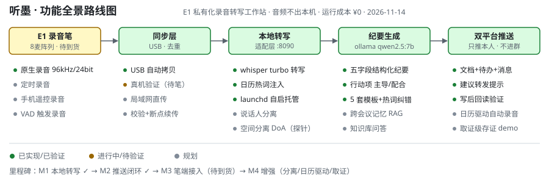

# 听墨路线图

## 里程碑

| 阶段 | 内容 | 状态 |
|---|---|---|
| M1 本地转写 | whisper.cpp turbo + ollama 适配层，样本冒烟 | ✅ 已验证 |
| M2 推送闭环 | 行动项结构化（主导/配合）+ 双平台文档/待办/消息 + 日历热词 + launchd | ✅ 演示验证 |
| M3 笔端接入 | 开 adb → 只读探针 → dd 备份 → USB 同步 → e1daemon（直传/定时/遥控） | ⏳ 待笔到货 |
| M4 增强 | 说话人分离 / 日历驱动录音 / 取证 demo / RAG 问答 | 规划 |

## 进行中

- 听墨品牌构建：需 Xcode 26（swift.org 6.0.3 崩溃、6.1.2 病态慢，已证伪）；官方 v1.3.2 DMG 功能等价，不阻塞使用
- M3 真机全链路：等录音笔到货

## 扩展储备（底座打通后顺手做）

语音备忘第二大脑 · 高保真录音归档 · 课堂笔记 · 离线翻译机 · 访谈工具 · 高校录播 · 本地唤醒词助手 · 睡眠监测 · 对讲机

## 明确不做

儿童熏听机 · 蓝牙随身听 · 刷固件/分区表 · 端侧 ASR · 自动进群 · 一期实时流式

详见 [E1功能全景研究](../E1功能全景研究.md) 与 [PRD](../PRD.md)。